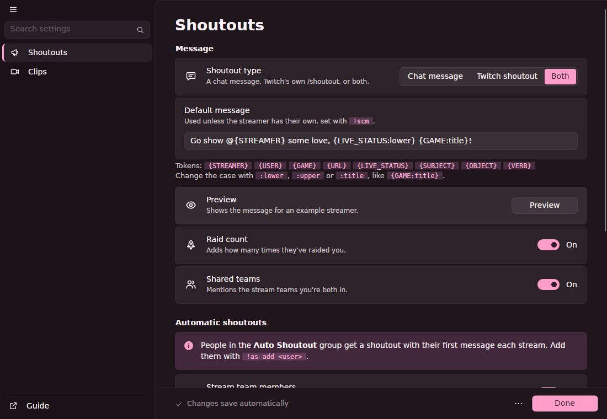
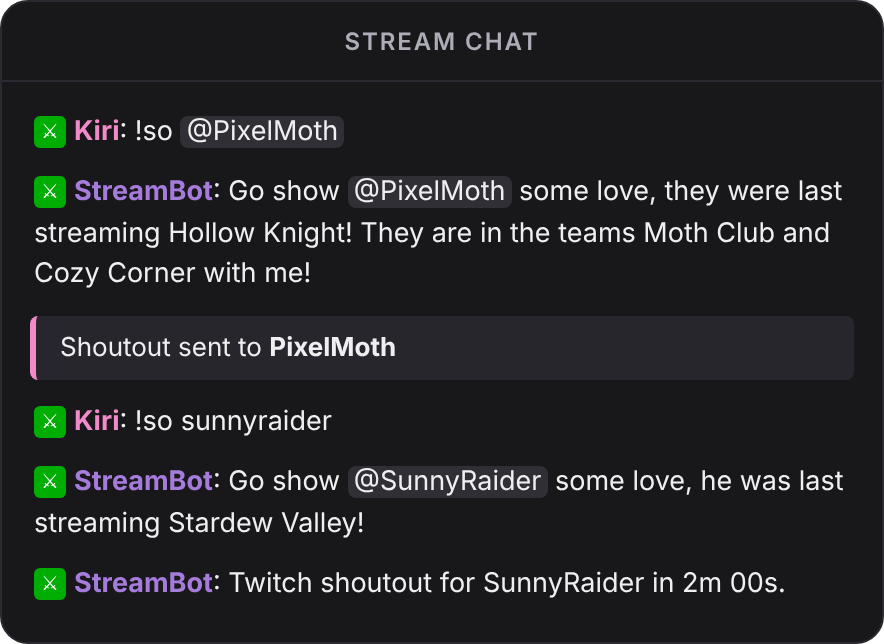
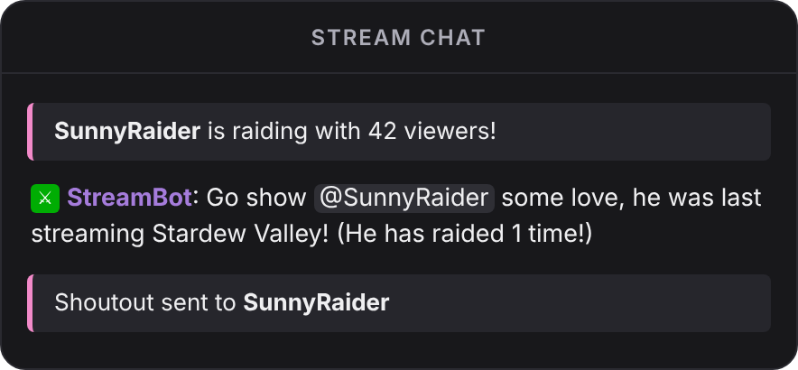
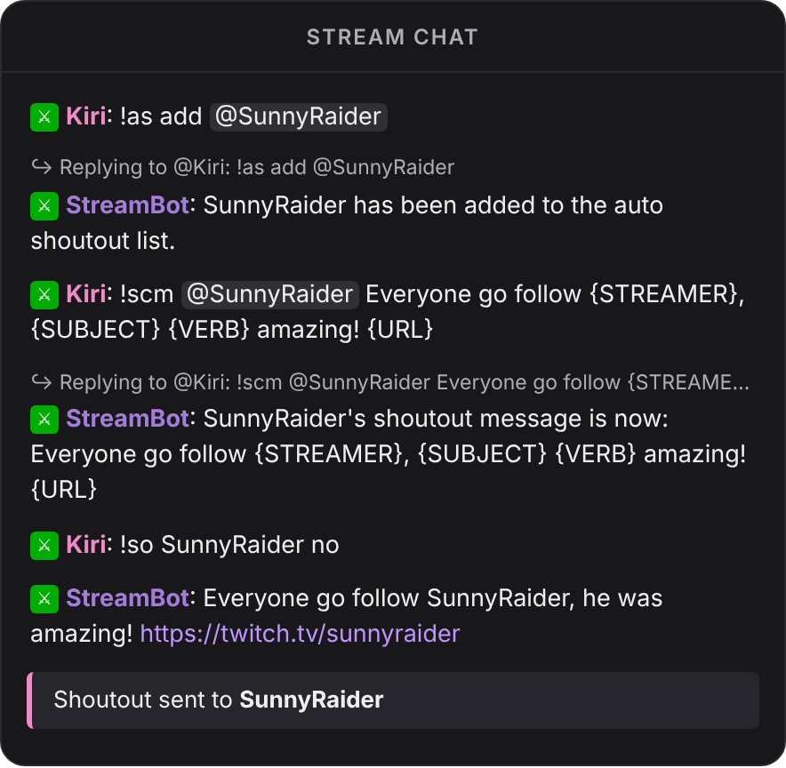
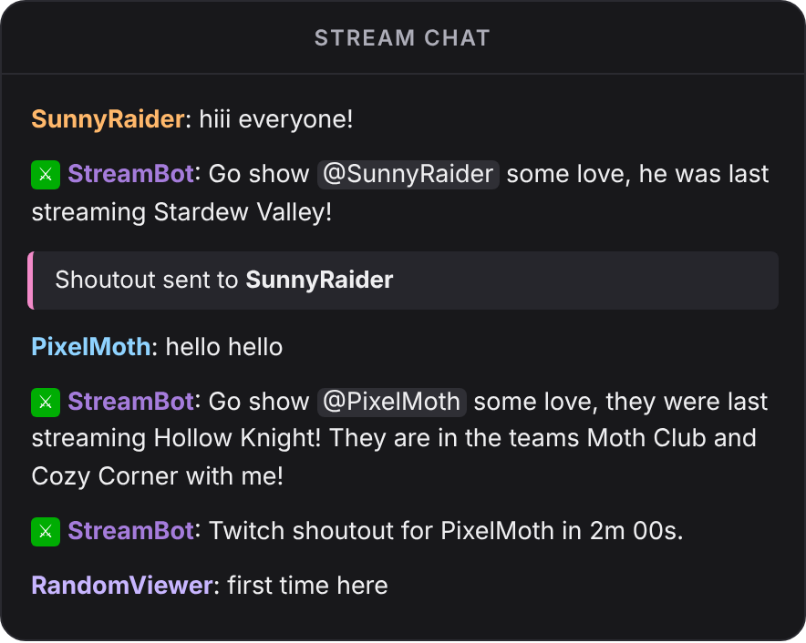
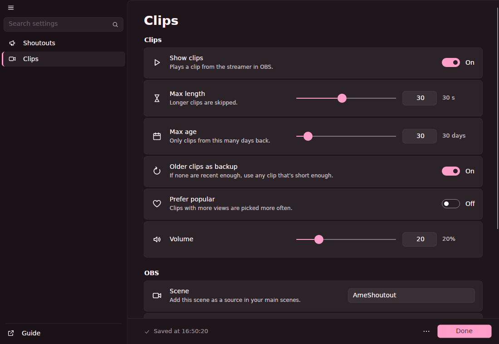

# AmeShoutout

Shoutouts for [Streamer.bot](https://streamer.bot) that play a clip of the streamer in OBS, use their pronouns, and handle Twitch's `/shoutout` limits for you.

Everything runs from one action, with a settings window made with [OrchidUI](https://github.com/AmeliaFromFinance/OrchidUI).

## Features

- Shoutouts by command, on raids, or on someone's first message of the stream
- Plays a random clip from the streamer, or one you pick
- Pronouns from [pr.alejo.io](https://pr.alejo.io/)
- Twitch `/shoutout` queue that waits out the cooldowns for you
- Custom message per streamer
- Raid count and shared stream teams in the message
- Auto shoutouts for a list of people and your stream team members

  
  

## Install

1. Install OrchidUI from its [latest release](https://github.com/AmeliaFromFinance/OrchidUI/releases/latest): put `OrchidUI.dll` next to `Streamer.bot.exe` and unzip the host into an `OrchidUI` folder beside it. The [OrchidUI readme](https://github.com/AmeliaFromFinance/OrchidUI#install) has the details for Linux and macOS.
2. Copy everything in [`ImportString.txt`](ImportString.txt).
3. In Streamer.bot, click **Import**, paste it and click **Import**.
4. Go to **Commands**, right-click the **[Ame] Shoutout** group and click **Enable All**.
5. The settings window opens by itself. To open it later, right-click the **Test** trigger on the **Shoutout** action and click **Test Trigger**.
6. On the **Clips** tab, click **Set up OBS**. Then add the `AmeShoutout` scene as a source in the scenes where you want clips to show.

Settings save as you change them.

> [!NOTE]
> Coming from 3.x? Delete the old **Configuration**, **Auto Shoutout** and **Custom Message** actions first, and the **[WhazzItToYa] Web Configurator** ones if nothing else uses them. Your old settings, custom messages, raid counts and Auto Shoutout list carry over.

## Commands

Moderators can use these by default.

| Command | What it does |
|---|---|
| `!so <user>` | Shoutout with a random clip |
| `!so <user> no` | Shoutout without a clip |
| `!so <user> <clip link>` | Shoutout with that clip |
| `!as add <user>` | Adds them to the auto shoutout list |
| `!as remove <user>` | Takes them off the list |
| `!scm <user> <message>` | Gives them their own shoutout message |
| `!scm <user>` | Puts them back on the default message |

`!shoutout`, `!autoshoutout` and `!setcustommessage` work too.

## Automatic shoutouts

Someone gets a shoutout with their first message of the stream if they're on the auto shoutout list, or if **Stream team members** is on and they share a stream team with you.

Nobody gets shouted out twice within an hour, so a raider who then chats only gets one.

## Message tokens

| Token | Becomes |
|---|---|
| `{STREAMER}` | Their name |
| `{USER}` | Who typed `!so` |
| `{GAME}` | What they're streaming, or last streamed |
| `{URL}` | `https://twitch.tv/their-name` |
| `{LIVE_STATUS}` | `she is currently streaming` or `she was last streaming` |
| `{SUBJECT}` | `she`, `he`, `they`, … |
| `{OBJECT}` | `her`, `him`, `them`, … |
| `{VERB}` | `is` / `are` when live, `was` / `were` when not |

Add `:lower`, `:upper` or `:title` to change the case, like `{GAME:title}`. People with no pronouns set, or set to Any or Other, get they/them.

The default message is `Go show @{STREAMER} some love, {LIVE_STATUS:lower} {GAME:title}!`

## Twitch /shoutout

Twitch allows one `/shoutout` every 2 minutes, and the same streamer once an hour. AmeShoutout queues them and says in chat when one has to wait. A streamer who already had one in the last hour is skipped. `/shoutout` only works while you're live.

## Clips

Clips are picked from the last 30 days and up to 30 seconds long. Both can be changed on the **Clips** tab, along with the volume and an optional text source that shows with the clip. If more than one shoutout happens at once, the clips play one after another.

## Problems

Everything AmeShoutout does is in the Streamer.bot log, starting with `[AmeShoutout]`. Turn on **Problems in chat** to see them in chat too.

| Problem | Fix |
|---|---|
| Settings window doesn't open | Check OrchidUI is installed, then see the [OrchidUI troubleshooting](https://github.com/AmeliaFromFinance/OrchidUI#troubleshooting) |
| `OBS isn't connected` | Connect OBS in Streamer.bot under **Stream Apps** |
| Clip plays but there's no sound | Check the media source isn't muted in OBS, and the volume on the **Clips** tab |
| `Twitch didn't accept the shoutout` | You need to be live, and the streamer can't have had one in the last hour |
